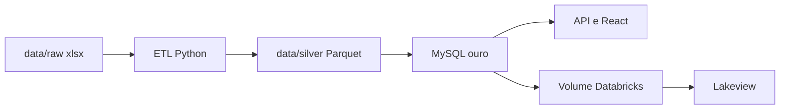

# Dashboard IBGE

## 1. Objetivo

Painel das Projeções da População do IBGE, revisão 2024. A API é FastAPI, o site é React e o painel da rubrica é o Databricks Lakeview. Não há arquivo Power BI nem medida DAX.

URL: dash.clevo.com.br

## 2. Arquitetura



## 3. Camadas

- **raw:** `data/raw/*.xlsx`, as cinco planilhas versionadas.
- **silver:** `data/silver/`. O Parquet completo fica de fora do Git. `data/silver/README.md` e `data/silver/amostra/` entram no repositório. Se `data/processed/` ainda existir, a API move o conteúdo uma vez.
- **ouro:** tabelas MySQL de `apps/api/app/repositories/schema.py`. O DDL está em `apps/api/sql/ddl_ouro.sql`.

## 4. Passo a passo do ETL e da carga

Na pasta `apps/api`, com as planilhas em `data/raw/`:

```bash
python -m app.tools.run_all
python -m app.tools.make_sample
python -m app.tools.load_mysql_from_parquet
python -m app.tools.eda
```

`run_all` grava a silver. `load_mysql_from_parquet` sobe o Alembic e troca as fatos originais em lotes de 10 mil, dentro de uma transação. A fonte `sujo` grava só `etl_runs`. Se um valor de referência divergir, a carga desfaz a transação, marca `etl_runs` como `failed` e o processo sai com código diferente de zero.

A revisão `003_restricoes_ouro` apaga e recria as fatos. É preciso rodar a carga depois do upgrade.

## 5. Modelo de dados

O diagrama, as colunas, os tipos, as chaves e os CHECK estão em `docs/DER.md`. O script equivalente é `apps/api/sql/ddl_ouro.sql` (`python -m app.tools.dump_ddl`).

## 6. EDA

O relatório é `docs/RELATORIO_EDA.md`. Os números e os gráficos saem de `docs/eda/`, gerados por `python -m app.tools.eda`.

## 7. Painel Databricks

O passo a passo, as duas formas de ler o MySQL e a lista de capturas estão em `docs/PAINEL_DATABRICKS.md`.

## 8. Como rodar os testes

```bash
cd apps/api && python -m pytest
cd apps/web && npm test
npx playwright test
```

A carga MySQL usa `TEST_MYSQL_URL` (MySQL 8). Sem essa variável, os testes marcados `mysql` são pulados. Testes da base inteira, sem o Parquet completo, pulam com o motivo "base completa". O CI sobe MySQL 8.4 e roda `pytest -m "mysql or not mysql"`.

## 9. Deploy com Docker

```bash
docker compose up -d --build
docker compose exec api python -m app.tools.load_mysql_from_parquet
```

O site fica em `http://localhost:8082`, a API em `http://localhost:8001` e o MySQL em `3306`. Sem Docker: a API em `apps/api/README.md` e o frontend com `npm run dev -w @ibge/web` em `http://127.0.0.1:5173`.

Depois do upgrade, confira no MySQL a soma do Brasil em 2026 (214.211.951) e zero atípicos na ds1. O comando da carga já falha se esses valores divergirem.

## 10. Débitos atuais

- Notícias da Agência IBGE podem vir fora do tema quando a busca é ampla.
- A tabela paginada pede a página de novo a cada ano, enquanto a pirâmide já fica em memória.
- As capturas do Lakeview e o PDF `docs/painel-databricks.pdf` dependem de uma conta no workspace.
- A variante Federation depende de a rede do Databricks alcançar o MySQL.
- A revisão 003 recria as fatos vazias até a carga original rodar de novo.

## 11. Prompts de IA

# Prompts para o Cursor

Copie as pastas `.cursor/`, `specs/` e `assets/` para a raiz do projeto. As etapas são as onze pastas `specs/01-` a `specs/11-`, na ordem do `specs/README.md`. Coloque as 5 planilhas em `data/raw/` com estes nomes:

| Arquivo original | Renomear para |
|---|---|
| `projecoes_2024_tab1_idade_simples.xlsx` | `tab1_idade_simples.xlsx` |
| `projecoes_2024_tab2_grupo_quinquenal.xlsx` | `tab2_grupo_quinquenal.xlsx` |
| `projecoes_2024_tab3_grupos_etarios_especificos.xlsx` | `tab3_grupos_etarios_especificos.xlsx` |
| `projecoes_2024_tab4_indicadores.xlsx` | `tab4_indicadores.xlsx` |
| `projecoes_2024_tab5_tabuas_mortalidade.xlsx` | `tab5_tabuas_mortalidade.xlsx` |

Use o modo Agent.

Os prompts são curtos de propósito: o conteúdo está nas specs e as regras de economia de tokens são carregadas automaticamente.

---

## Prompt 1: Backend e pipeline de dados

```
Atue como desenvolvedor Fullstack sênior. Implemente a Etapa 1 seguindo @specs/01-backend/requirements.md, @specs/01-backend/design.md e @specs/01-backend/tasks.md, com @specs/DATA_PROFILE.md como referência dos dados.
Comece pela primeira tarefa não marcada. Ao terminar cada tarefa, marque [x] e continue para a próxima, até concluir a etapa ou encontrar um bloqueio.
```

## Prompt 2: Design system e base do frontend

```
Atue como desenvolvedor Frontend sênior e Product Designer. Implemente a Etapa 2 seguindo @specs/02-frontend-base/requirements.md, @specs/02-frontend-base/design.md e @specs/02-frontend-base/tasks.md.
Comece pela primeira tarefa não marcada. Ao terminar cada tarefa, marque [x] e continue para a próxima, até concluir a etapa ou encontrar um bloqueio.
```

## Prompt 3: Dashboards, notícias e acabamento

```
Atue como desenvolvedor Fullstack sênior e Product Designer. Implemente a Etapa 3 seguindo @specs/03-dashboards/requirements.md, @specs/03-dashboards/design.md e @specs/03-dashboards/tasks.md, usando @datasets.yaml e @specs/DECISIONS.md como contexto.
Comece pela primeira tarefa não marcada. Ao terminar cada tarefa, marque [x] e continue para a próxima, até concluir a etapa ou encontrar um bloqueio.
```

## Prompt 4: Modos de navegação, acessibilidade, fatos, Insights e correções de backend

```
Atue como desenvolvedor Fullstack sênior, especialista em acessibilidade e Product Designer. Implemente a Etapa 4 seguindo @specs/04-modos-acessibilidade-insights/requirements.md, @specs/04-modos-acessibilidade-insights/design.md e @specs/04-modos-acessibilidade-insights/tasks.md. Use os conteúdos prontos de @specs/04-modos-acessibilidade-insights/conteudo sem reescrevê-los. Esta etapa prevalece sobre as etapas 1–3.
Comece pela primeira tarefa não marcada. Ao terminar cada tarefa, marque [x] e continue para a próxima, até concluir a spec ou encontrar um bloqueio.
```

## Prompt 5: Filtros, contexto, base de demonstração e Insights

```
Atue como desenvolvedor Fullstack sênior. Implemente a Etapa 5 seguindo @specs/05-filtros-contexto-insights/requirements.md, @specs/05-filtros-contexto-insights/design.md e @specs/05-filtros-contexto-insights/tasks.md.
Comece pela primeira tarefa não marcada. Ao terminar cada tarefa, marque [x] e continue para a próxima, até concluir a etapa ou encontrar um bloqueio.
```

## Prompt 6: Negócio, confiabilidade e storytelling

```
Atue como desenvolvedor Fullstack sênior. Implemente a Etapa 6 seguindo @specs/06-negocio-confiabilidade-storytelling/requirements.md, @specs/06-negocio-confiabilidade-storytelling/design.md e @specs/06-negocio-confiabilidade-storytelling/tasks.md.
Comece pela primeira tarefa não marcada. Ao terminar cada tarefa, marque [x] e continue para a próxima, até concluir a etapa ou encontrar um bloqueio.
```

## Prompt 7: Animações opcionais

```
Atue como desenvolvedor Frontend sênior. Implemente a Etapa 7 seguindo @specs/07-animacoes-opcionais/requirements.md, @specs/07-animacoes-opcionais/design.md e @specs/07-animacoes-opcionais/tasks.md.
Comece pela primeira tarefa não marcada. Ao terminar cada tarefa, marque [x] e continue para a próxima, até concluir a etapa ou encontrar um bloqueio.
```

## Prompt 8: Reavaliação em produção

```
Atue como desenvolvedor Fullstack sênior. Implemente a Etapa 8 seguindo @specs/08-negocio-confiabilidade-storytelling-v2/requirements.md, @specs/08-negocio-confiabilidade-storytelling-v2/design.md e @specs/08-negocio-confiabilidade-storytelling-v2/tasks.md. Esta etapa prevalece sobre a 6 nos pontos em que divergir.
Comece pela primeira tarefa não marcada. Ao terminar cada tarefa, marque [x] e continue para a próxima, até concluir a etapa ou encontrar um bloqueio.
```

## Prompt 9: Ajustes da avaliação

```
Atue como desenvolvedor Fullstack sênior. Implemente a Etapa 9 seguindo @specs/09-ajustes-avaliacao/requirements.md, @specs/09-ajustes-avaliacao/design.md e @specs/09-ajustes-avaliacao/tasks.md, com @specs/DATA_PROFILE.md como referência dos dados.
Comece pela primeira tarefa não marcada. Ao terminar cada tarefa, marque [x] e continue para a próxima, até concluir a etapa ou encontrar um bloqueio.
```

## Prompt 10: Rubrica de entrega

```
Atue como desenvolvedor Fullstack sênior. Implemente a Etapa 10 seguindo @specs/10-rubrica-entrega/requirements.md, @specs/10-rubrica-entrega/design.md e @specs/10-rubrica-entrega/tasks.md. O painel da rubrica é o Databricks, no lugar do Power BI.
Comece pela primeira tarefa não marcada. Ao terminar cada tarefa, marque [x] e continue para a próxima, até concluir a etapa ou encontrar um bloqueio.
```

## Prompt 11: Finalização pela rubrica

```
Atue como desenvolvedor Fullstack sênior. Implemente a Etapa 11 seguindo @specs/11-finalizacao-rubrica/requirements.md, @specs/11-finalizacao-rubrica/design.md e @specs/11-finalizacao-rubrica/tasks.md. Esta etapa prevalece sobre a 10 na pasta silver, nas docstrings, na EDA e na leitura do MySQL pelo Databricks.
Comece pela primeira tarefa não marcada. Ao terminar cada tarefa, marque [x] e continue para a próxima, até concluir a etapa ou encontrar um bloqueio.
```

---

**Se o Cursor parar no meio de uma etapa** (limite de contexto ou erro), abra um chat novo e reenvie o mesmo prompt: ele retoma da primeira tarefa sem `[x]`. Chats novos por etapa também economizam tokens.
