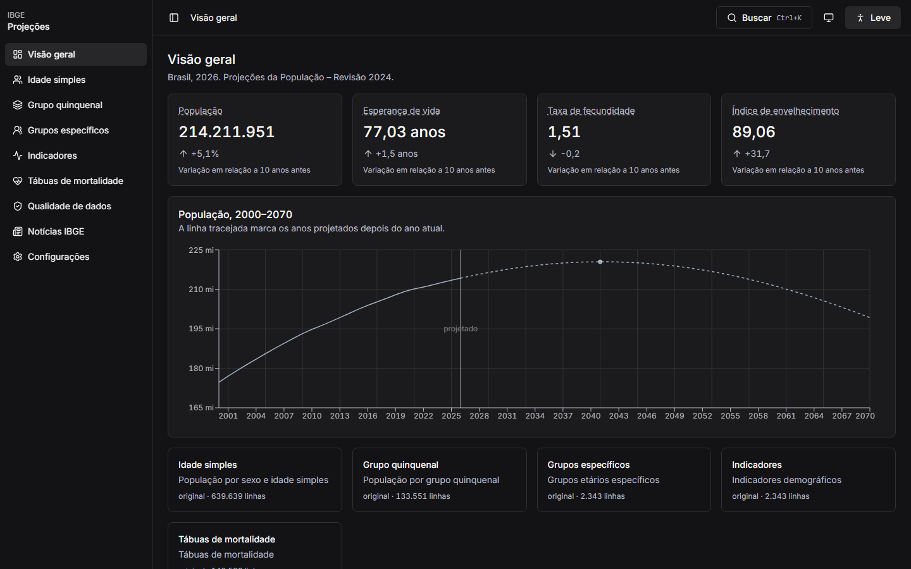
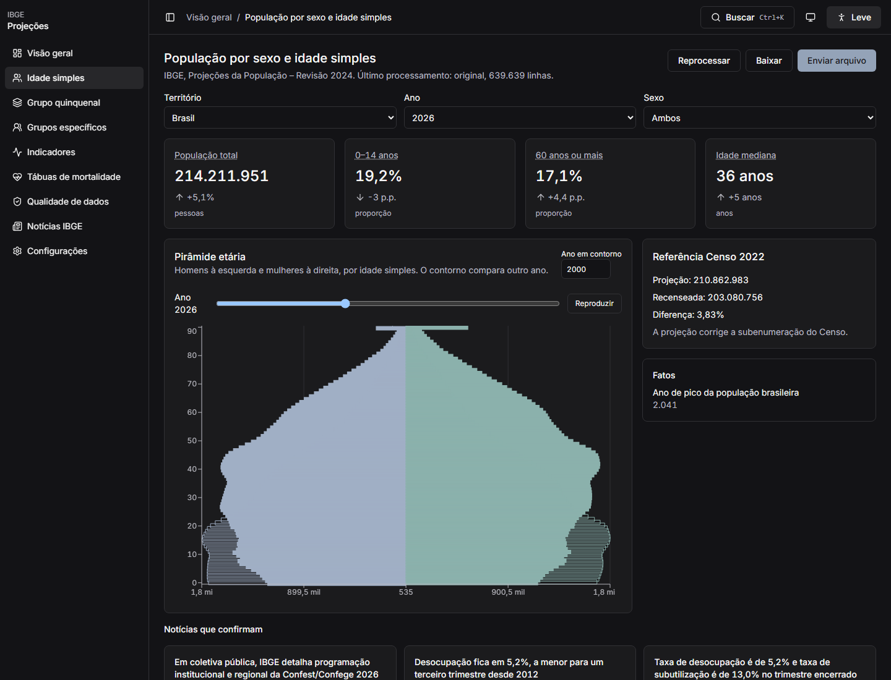
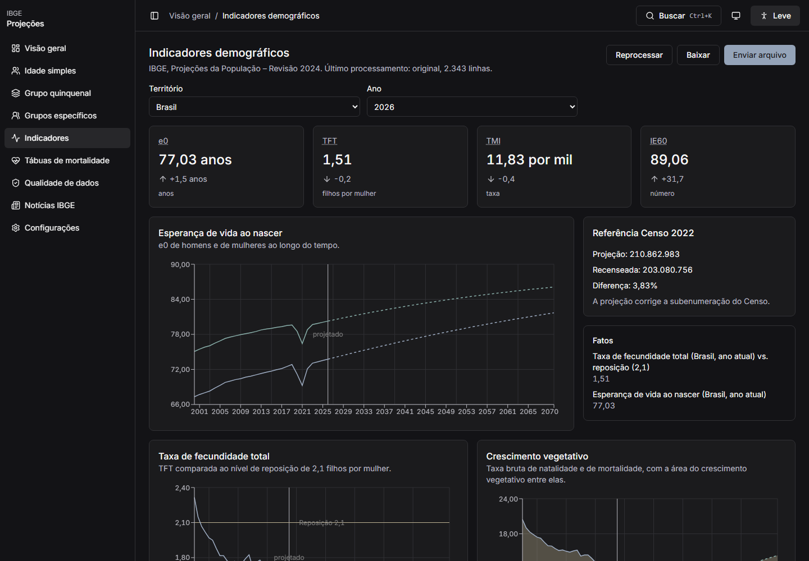
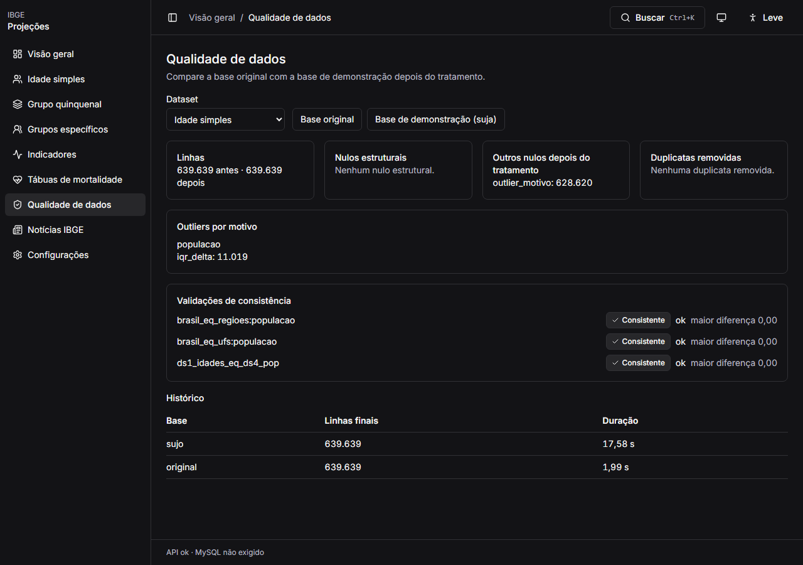
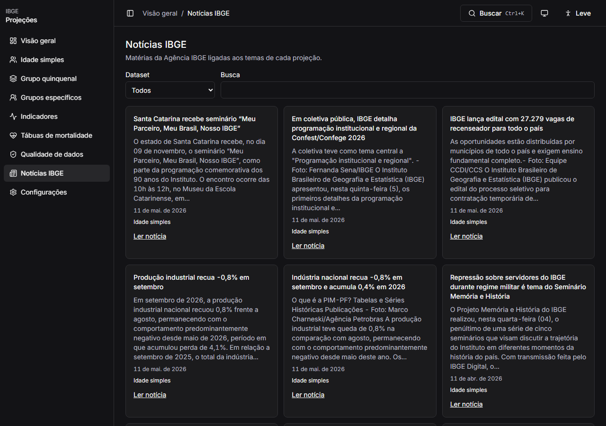
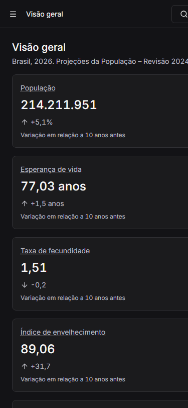

# Dashboard IBGE

Painel das Projeções da População (revisão 2024): API FastAPI, frontend React e pacote compartilhado.

```bash
docker compose up --build
```

O site fica em `http://localhost:8082` (nginx), a API em `http://localhost:8001` e o MySQL em `3306`. Sem Docker: a API em `apps/api/README.md` e o frontend com `npm run dev -w @ibge/web` em `http://127.0.0.1:5173`.

## Telas













## Débitos

- A linha do gráfico só aparece ao fim da animação; no Modo leve ela entra direto.
- O eixo da pirâmide ainda mostra um rótulo solto perto do zero.
- Notícias da Agência IBGE podem vir fora do tema quando a busca é ampla.
- Nesta máquina o MySQL local estava parado; o compose sobe o banco e exige a carga.
- A tabela paginada pede a página de novo a cada ano, enquanto a pirâmide já fica em memória.
