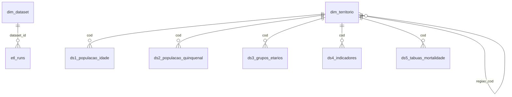

# DER da camada ouro

As fatos repetem `sigla`, `local` e `nivel`, que já estão em `dim_territorio`. A repetição existe para a API e o Databricks lerem o fato sem join. Um teste de carga confere que esses três campos batem com a dimensão.

`regiao_cod` é nulo no Brasil e nas regiões. Nas UFs aponta para o `cod` da região.

A revisão `003_restricoes_ouro` apaga e recria as fatos. A carga seguinte repõe as linhas. O DDL gerado está em `apps/api/sql/ddl_ouro.sql`.

## dim_dataset

| coluna | tipo | nulo | papel |
|---|---|---|---|
| id | VARCHAR(8) | não | PK |
| nome | VARCHAR(120) | não | — |

## dim_metrica

| coluna | tipo | nulo | papel |
|---|---|---|---|
| dataset_id | VARCHAR(8) | não | PK |
| coluna | VARCHAR(64) | não | PK |
| rotulo | VARCHAR(120) | não | — |
| descricao | VARCHAR(255) | não | — |
| unidade | VARCHAR(40) | não | — |

## dim_territorio

| coluna | tipo | nulo | papel |
|---|---|---|---|
| cod | INTEGER | não | PK |
| sigla | VARCHAR(8) | não | — |
| local | VARCHAR(80) | não | — |
| nivel | VARCHAR(16) | não | — |
| regiao_cod | INTEGER | sim | FK → dim_territorio.cod |

## ds1_populacao_idade

| coluna | tipo | nulo | papel |
|---|---|---|---|
| idade | INTEGER | não | PK |
| sexo | VARCHAR(24) | não | PK |
| cod | INTEGER | não | PK, FK → dim_territorio.cod |
| sigla | VARCHAR(8) | sim | — |
| local | VARCHAR(80) | sim | — |
| nivel | VARCHAR(16) | sim | — |
| ano | INTEGER | não | PK |
| populacao | BIGINT | sim | — |
| is_outlier | BOOLEAN | sim | — |
| outlier_motivo | TEXT | sim | — |

Restrições:

- `ck_ds1_populacao_idade_contagens`: populacao >= 0
- `ck_ds1_populacao_idade_ano`: ano BETWEEN 2000 AND 2070
- `ck_ds1_populacao_idade_sexo`: sexo IN ('Ambos', 'Homens', 'Mulheres')
- `ck_ds1_populacao_idade_idade`: idade BETWEEN 0 AND 90

## ds2_populacao_quinquenal

| coluna | tipo | nulo | papel |
|---|---|---|---|
| grupo_etario | VARCHAR(16) | não | PK |
| idade_inicio | INTEGER | sim | — |
| sexo | VARCHAR(24) | não | PK |
| cod | INTEGER | não | PK, FK → dim_territorio.cod |
| sigla | VARCHAR(8) | sim | — |
| local | VARCHAR(80) | sim | — |
| nivel | VARCHAR(16) | sim | — |
| ano | INTEGER | não | PK |
| populacao | BIGINT | sim | — |
| is_outlier | BOOLEAN | sim | — |
| outlier_motivo | TEXT | sim | — |

Restrições:

- `ck_ds2_populacao_quinquenal_ano`: ano BETWEEN 2000 AND 2070
- `ck_ds2_populacao_quinquenal_contagens`: populacao >= 0
- `ck_ds2_populacao_quinquenal_sexo`: sexo IN ('Ambos', 'Homens', 'Mulheres')

## ds3_grupos_etarios

| coluna | tipo | nulo | papel |
|---|---|---|---|
| ano | INTEGER | não | PK |
| cod | INTEGER | não | PK, FK → dim_territorio.cod |
| sigla | VARCHAR(8) | sim | — |
| local | VARCHAR(80) | sim | — |
| pop_t | BIGINT | sim | — |
| pop_h | BIGINT | sim | — |
| pop_m | BIGINT | sim | — |
| n_0_1_t | BIGINT | sim | — |
| n_0_1_h | BIGINT | sim | — |
| n_0_1_m | BIGINT | sim | — |
| n_0_4_t | BIGINT | sim | — |
| n_0_4_h | BIGINT | sim | — |
| n_0_4_m | BIGINT | sim | — |
| n_0_14_t | BIGINT | sim | — |
| n_0_14_h | BIGINT | sim | — |
| n_0_14_m | BIGINT | sim | — |
| n_15_17_t | BIGINT | sim | — |
| n_15_17_h | BIGINT | sim | — |
| n_15_17_m | BIGINT | sim | — |
| n_18_21_t | BIGINT | sim | — |
| n_18_21_h | BIGINT | sim | — |
| n_18_21_m | BIGINT | sim | — |
| n_15_59_t | BIGINT | sim | — |
| n_15_59_h | BIGINT | sim | — |
| n_15_59_m | BIGINT | sim | — |
| n_15_64_t | BIGINT | sim | — |
| n_15_64_h | BIGINT | sim | — |
| n_15_64_m | BIGINT | sim | — |
| n_60_mais_t | BIGINT | sim | — |
| n_60_mais_h | BIGINT | sim | — |
| n_60_mais_m | BIGINT | sim | — |
| n_65_mais_t | BIGINT | sim | — |
| n_65_mais_h | BIGINT | sim | — |
| n_65_mais_m | BIGINT | sim | — |
| n_80_mais_t | BIGINT | sim | — |
| n_80_mais_h | BIGINT | sim | — |
| n_80_mais_m | BIGINT | sim | — |
| p_h | NUMERIC(18, 6) | sim | — |
| p_m | NUMERIC(18, 6) | sim | — |
| p_0_1_t | NUMERIC(18, 6) | sim | — |
| p_0_1_h | NUMERIC(18, 6) | sim | — |
| p_0_1_m | NUMERIC(18, 6) | sim | — |
| p_0_4_t | NUMERIC(18, 6) | sim | — |
| p_0_4_h | NUMERIC(18, 6) | sim | — |
| p_0_4_m | NUMERIC(18, 6) | sim | — |
| p_0_14_t | NUMERIC(18, 6) | sim | — |
| p_0_14_h | NUMERIC(18, 6) | sim | — |
| p_0_14_m | NUMERIC(18, 6) | sim | — |
| p_15_17_t | NUMERIC(18, 6) | sim | — |
| p_15_17_h | NUMERIC(18, 6) | sim | — |
| p_15_17_m | NUMERIC(18, 6) | sim | — |
| p_18_21_t | NUMERIC(18, 6) | sim | — |
| p_18_21_h | NUMERIC(18, 6) | sim | — |
| p_18_21_m | NUMERIC(18, 6) | sim | — |
| p_15_59_t | NUMERIC(18, 6) | sim | — |
| p_15_59_h | NUMERIC(18, 6) | sim | — |
| p_15_59_m | NUMERIC(18, 6) | sim | — |
| p_15_64_t | NUMERIC(18, 6) | sim | — |
| p_15_64_h | NUMERIC(18, 6) | sim | — |
| p_15_64_m | NUMERIC(18, 6) | sim | — |
| p_60_mais_t | NUMERIC(18, 6) | sim | — |
| p_60_mais_h | NUMERIC(18, 6) | sim | — |
| p_60_mais_m | NUMERIC(18, 6) | sim | — |
| p_65_mais_t | NUMERIC(18, 6) | sim | — |
| p_65_mais_h | NUMERIC(18, 6) | sim | — |
| p_65_mais_m | NUMERIC(18, 6) | sim | — |
| p_80_mais_t | NUMERIC(18, 6) | sim | — |
| p_80_mais_h | NUMERIC(18, 6) | sim | — |
| p_80_mais_m | NUMERIC(18, 6) | sim | — |
| nivel | VARCHAR(16) | sim | — |
| is_outlier | BOOLEAN | sim | — |
| outlier_motivo | TEXT | sim | — |

Restrições:

- `ck_ds3_grupos_etarios_ano`: ano BETWEEN 2000 AND 2070
- `ck_ds3_grupos_etarios_contagens`: pop_t >= 0 AND pop_h >= 0 AND pop_m >= 0 AND n_0_1_t >= 0 AND n_0_1_h >= 0 AND n_0_1_m >= 0 AND n_0_4_t >= 0 AND n_0_4_h >= 0 AND n_0_4_m >= 0 AND n_0_14_t >= 0 AND n_0_14_h >= 0 AND n_0_14_m >= 0 AND n_15_17_t >= 0 AND n_15_17_h >= 0 AND n_15_17_m >= 0 AND n_18_21_t >= 0 AND n_18_21_h >= 0 AND n_18_21_m >= 0 AND n_15_59_t >= 0 AND n_15_59_h >= 0 AND n_15_59_m >= 0 AND n_15_64_t >= 0 AND n_15_64_h >= 0 AND n_15_64_m >= 0 AND n_60_mais_t >= 0 AND n_60_mais_h >= 0 AND n_60_mais_m >= 0 AND n_65_mais_t >= 0 AND n_65_mais_h >= 0 AND n_65_mais_m >= 0 AND n_80_mais_t >= 0 AND n_80_mais_h >= 0 AND n_80_mais_m >= 0
- `ck_ds3_grupos_etarios_proporcoes`: p_h BETWEEN 0 AND 1 AND p_m BETWEEN 0 AND 1 AND p_0_1_t BETWEEN 0 AND 1 AND p_0_1_h BETWEEN 0 AND 1 AND p_0_1_m BETWEEN 0 AND 1 AND p_0_4_t BETWEEN 0 AND 1 AND p_0_4_h BETWEEN 0 AND 1 AND p_0_4_m BETWEEN 0 AND 1 AND p_0_14_t BETWEEN 0 AND 1 AND p_0_14_h BETWEEN 0 AND 1 AND p_0_14_m BETWEEN 0 AND 1 AND p_15_17_t BETWEEN 0 AND 1 AND p_15_17_h BETWEEN 0 AND 1 AND p_15_17_m BETWEEN 0 AND 1 AND p_18_21_t BETWEEN 0 AND 1 AND p_18_21_h BETWEEN 0 AND 1 AND p_18_21_m BETWEEN 0 AND 1 AND p_15_59_t BETWEEN 0 AND 1 AND p_15_59_h BETWEEN 0 AND 1 AND p_15_59_m BETWEEN 0 AND 1 AND p_15_64_t BETWEEN 0 AND 1 AND p_15_64_h BETWEEN 0 AND 1 AND p_15_64_m BETWEEN 0 AND 1 AND p_60_mais_t BETWEEN 0 AND 1 AND p_60_mais_h BETWEEN 0 AND 1 AND p_60_mais_m BETWEEN 0 AND 1 AND p_65_mais_t BETWEEN 0 AND 1 AND p_65_mais_h BETWEEN 0 AND 1 AND p_65_mais_m BETWEEN 0 AND 1 AND p_80_mais_t BETWEEN 0 AND 1 AND p_80_mais_h BETWEEN 0 AND 1 AND p_80_mais_m BETWEEN 0 AND 1

## ds4_indicadores

| coluna | tipo | nulo | papel |
|---|---|---|---|
| ano | INTEGER | não | PK |
| cod | INTEGER | não | PK, FK → dim_territorio.cod |
| sigla | VARCHAR(8) | sim | — |
| local | VARCHAR(80) | sim | — |
| pop_t | BIGINT | sim | — |
| pop_h | BIGINT | sim | — |
| pop_m | BIGINT | sim | — |
| tcg_t | NUMERIC(18, 6) | sim | — |
| tcg_h | NUMERIC(18, 6) | sim | — |
| tcg_m | NUMERIC(18, 6) | sim | — |
| rs | NUMERIC(18, 6) | sim | — |
| nasc_t | NUMERIC(14, 2) | sim | — |
| nasc_h | NUMERIC(14, 2) | sim | — |
| nasc_m | NUMERIC(14, 2) | sim | — |
| obt_t | NUMERIC(14, 2) | sim | — |
| obt_h | NUMERIC(14, 2) | sim | — |
| obt_m | NUMERIC(14, 2) | sim | — |
| tbn | NUMERIC(18, 6) | sim | — |
| tbm | NUMERIC(18, 6) | sim | — |
| tcv | NUMERIC(18, 6) | sim | — |
| e0_t | NUMERIC(18, 6) | sim | — |
| e0_h | NUMERIC(18, 6) | sim | — |
| e0_m | NUMERIC(18, 6) | sim | — |
| e60_t | NUMERIC(18, 6) | sim | — |
| e60_h | NUMERIC(18, 6) | sim | — |
| e60_m | NUMERIC(18, 6) | sim | — |
| tmi_t | NUMERIC(18, 6) | sim | — |
| tmi_h | NUMERIC(18, 6) | sim | — |
| tmi_m | NUMERIC(18, 6) | sim | — |
| n_5q0_t | NUMERIC(18, 6) | sim | — |
| n_5q0_h | NUMERIC(18, 6) | sim | — |
| n_5q0_m | NUMERIC(18, 6) | sim | — |
| n_45q15_t | NUMERIC(18, 6) | sim | — |
| n_45q15_h | NUMERIC(18, 6) | sim | — |
| n_45q15_m | NUMERIC(18, 6) | sim | — |
| n_20q60_t | NUMERIC(18, 6) | sim | — |
| n_20q60_h | NUMERIC(18, 6) | sim | — |
| n_20q60_m | NUMERIC(18, 6) | sim | — |
| tft | NUMERIC(18, 6) | sim | — |
| tef_10_14 | NUMERIC(18, 6) | sim | — |
| tef_15_19 | NUMERIC(18, 6) | sim | — |
| tef_20_24 | NUMERIC(18, 6) | sim | — |
| tef_25_29 | NUMERIC(18, 6) | sim | — |
| tef_30_34 | NUMERIC(18, 6) | sim | — |
| tef_35_39 | NUMERIC(18, 6) | sim | — |
| tef_40_44 | NUMERIC(18, 6) | sim | — |
| tef_45_49 | NUMERIC(18, 6) | sim | — |
| tef_50_mais | NUMERIC(18, 6) | sim | — |
| rdj60 | NUMERIC(18, 6) | sim | — |
| rdi60 | NUMERIC(18, 6) | sim | — |
| rdt60 | NUMERIC(18, 6) | sim | — |
| rdj65 | NUMERIC(18, 6) | sim | — |
| rdi65 | NUMERIC(18, 6) | sim | — |
| rdt65 | NUMERIC(18, 6) | sim | — |
| ie60 | NUMERIC(18, 6) | sim | — |
| ie65 | NUMERIC(18, 6) | sim | — |
| ie80 | NUMERIC(18, 6) | sim | — |
| id_m | NUMERIC(18, 6) | sim | — |
| id_med | NUMERIC(18, 6) | sim | — |
| nivel | VARCHAR(16) | sim | — |
| is_outlier | BOOLEAN | sim | — |
| outlier_motivo | TEXT | sim | — |

Restrições:

- `ck_ds4_indicadores_ano`: ano BETWEEN 2000 AND 2070
- `ck_ds4_indicadores_contagens`: pop_t >= 0 AND pop_h >= 0 AND pop_m >= 0 AND nasc_t >= 0 AND nasc_h >= 0 AND nasc_m >= 0 AND obt_t >= 0 AND obt_h >= 0 AND obt_m >= 0
- `ck_ds4_indicadores_esperanca`: e0_t BETWEEN 0 AND 120 AND e0_h BETWEEN 0 AND 120 AND e0_m BETWEEN 0 AND 120 AND e60_t BETWEEN 0 AND 120 AND e60_h BETWEEN 0 AND 120 AND e60_m BETWEEN 0 AND 120
- `ck_ds4_indicadores_tft`: tft BETWEEN 0 AND 10
- `ck_ds4_indicadores_tef`: tef_10_14 BETWEEN 0 AND 1 AND tef_15_19 BETWEEN 0 AND 1 AND tef_20_24 BETWEEN 0 AND 1 AND tef_25_29 BETWEEN 0 AND 1 AND tef_30_34 BETWEEN 0 AND 1 AND tef_35_39 BETWEEN 0 AND 1 AND tef_40_44 BETWEEN 0 AND 1 AND tef_45_49 BETWEEN 0 AND 1 AND tef_50_mais BETWEEN 0 AND 1
- `ck_ds4_indicadores_por_mil`: tmi_t BETWEEN 0 AND 1000 AND tmi_h BETWEEN 0 AND 1000 AND tmi_m BETWEEN 0 AND 1000 AND n_5q0_t BETWEEN 0 AND 1000 AND n_5q0_h BETWEEN 0 AND 1000 AND n_5q0_m BETWEEN 0 AND 1000 AND n_45q15_t BETWEEN 0 AND 1000 AND n_45q15_h BETWEEN 0 AND 1000 AND n_45q15_m BETWEEN 0 AND 1000 AND n_20q60_t BETWEEN 0 AND 1000 AND n_20q60_h BETWEEN 0 AND 1000 AND n_20q60_m BETWEEN 0 AND 1000
- `ck_ds4_indicadores_rs`: rs BETWEEN 50 AND 150
- `ck_ds4_indicadores_razoes`: rdj60 >= 0 AND rdi60 >= 0 AND rdt60 >= 0 AND rdj65 >= 0 AND rdi65 >= 0 AND rdt65 >= 0 AND ie60 >= 0 AND ie65 >= 0 AND ie80 >= 0
- `ck_ds4_indicadores_idade`: id_m BETWEEN 0 AND 120 AND id_med BETWEEN 0 AND 120

## ds5_tabuas_mortalidade

| coluna | tipo | nulo | papel |
|---|---|---|---|
| idade | INTEGER | não | PK |
| intervalo | NUMERIC(18, 6) | sim | — |
| intervalo_aberto | BOOLEAN | sim | — |
| sexo | VARCHAR(24) | não | PK |
| ano | INTEGER | não | PK |
| cod | INTEGER | não | PK, FK → dim_territorio.cod |
| sigla | VARCHAR(8) | sim | — |
| local | VARCHAR(80) | sim | — |
| nivel | VARCHAR(16) | sim | — |
| nmx | NUMERIC(18, 6) | sim | — |
| nax | NUMERIC(18, 6) | sim | — |
| nqx | NUMERIC(18, 6) | sim | — |
| lx | NUMERIC(18, 6) | sim | — |
| ndx | NUMERIC(18, 6) | sim | — |
| nlx | NUMERIC(18, 6) | sim | — |
| sx | NUMERIC(18, 6) | sim | — |
| tx | NUMERIC(18, 6) | sim | — |
| ex | NUMERIC(18, 6) | sim | — |
| is_outlier | BOOLEAN | sim | — |
| outlier_motivo | TEXT | sim | — |

Restrições:

- `ck_ds5_tabuas_mortalidade_idade`: idade BETWEEN 0 AND 90
- `ck_ds5_tabuas_mortalidade_sexo`: sexo IN ('Ambos', 'Homens', 'Mulheres')
- `ck_ds5_tabuas_mortalidade_nqx`: nqx BETWEEN 0 AND 1
- `ck_ds5_tabuas_mortalidade_ano`: ano BETWEEN 2000 AND 2070
- `ck_ds5_tabuas_mortalidade_nmx`: nmx >= 0
- `ck_ds5_tabuas_mortalidade_nax`: nax >= 0
- `ck_ds5_tabuas_mortalidade_sx`: sx BETWEEN 0 AND 1
- `ck_ds5_tabuas_mortalidade_lx`: lx BETWEEN 0 AND 100000
- `ck_ds5_tabuas_mortalidade_fluxos`: ndx >= 0 AND nlx >= 0 AND tx >= 0
- `ck_ds5_tabuas_mortalidade_ex`: ex BETWEEN 0 AND 120

## etl_runs

| coluna | tipo | nulo | papel |
|---|---|---|---|
| id | INTEGER | não | PK |
| dataset_id | VARCHAR(8) | não | FK → dim_dataset.id |
| source | VARCHAR(16) | não | — |
| status | VARCHAR(16) | não | — |
| started_at | DATETIME | não | — |
| finished_at | DATETIME | sim | — |
| rows_in | INTEGER | sim | — |
| rows_out | INTEGER | sim | — |
| report_json | JSON | sim | — |
| error | TEXT | sim | — |
