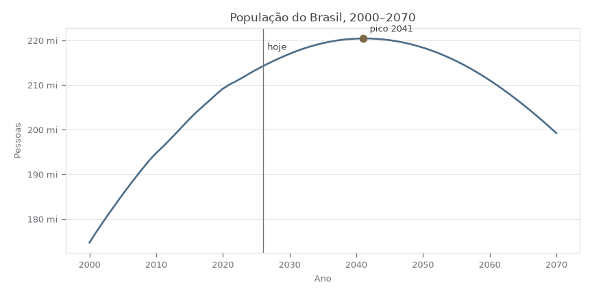
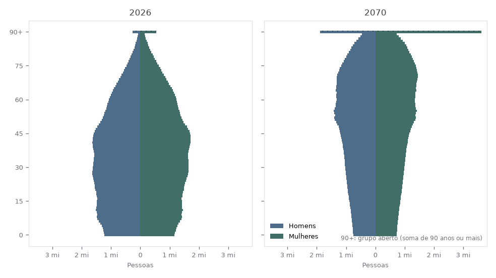
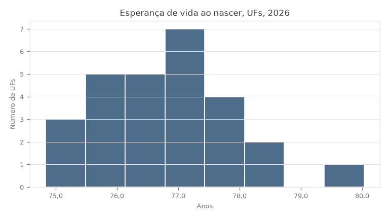
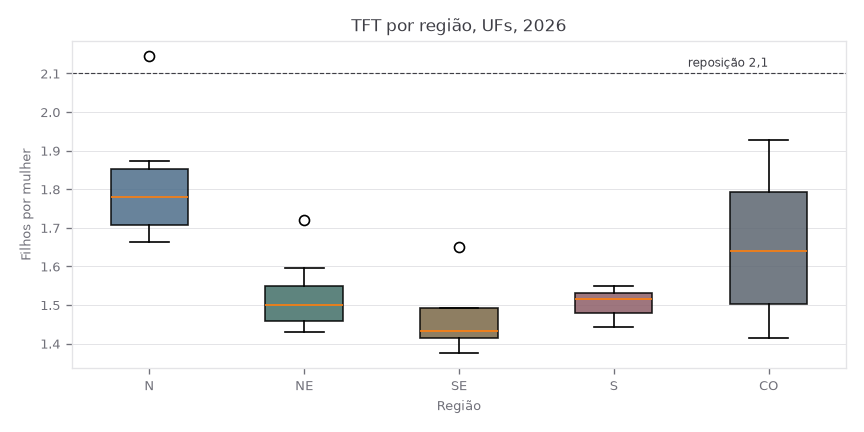
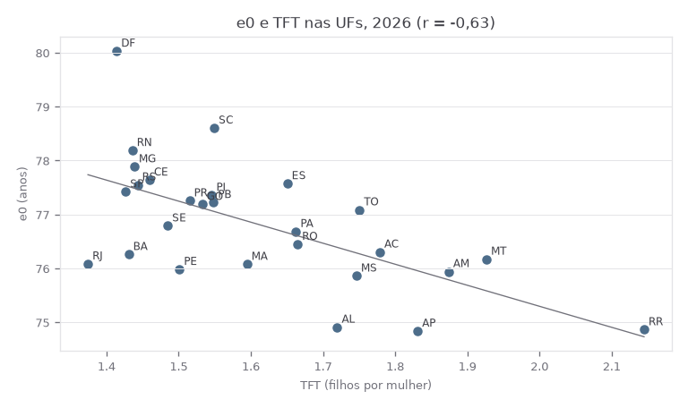

# Relatório de EDA — Projeções da População (revisão 2024)

Os números saem de `docs/eda/estatisticas.md`, gerado por `python -m app.tools.eda` sobre a silver. Casas decimais: no máximo duas.

## Qualidade dos dados

A ds1 larga tem 9.009 linhas (33 territórios × 3 sexos × 91 idades, de 0 a 90). No formato longo cada linha se repete nos 71 anos: 9.009 × 71 = 639.639. É a mesma projeção, não um acréscimo de pessoas.

| Base | Linhas depois da limpeza | Duplicatas na chave | Atípicos | Nulos que permanecem |
|---|---:|---:|---:|---|
| ds1 | 639.639 | 0 | 0 | nenhum |
| ds2 | 133.551 | 0 | 0 | nenhum |
| ds3 | 2.343 | 0 | 0 | nenhum |
| ds4 | 2.343 | 0 | 7 | 99 estruturais |
| ds5 | 140.580 | 0 | 0 | 7.029 no intervalo aberto |

Os 99 nulos são `tcg_t`, `tcg_h` e `tcg_m` em 2000, nos 33 territórios. Não há crescimento geométrico no primeiro ano, e o pipeline não imputa essa célula. Na ds1 original, `is_outlier` é 0.

População por idade no Brasil em 2026 (sexo Ambos, 91 idades): média 2.353.977, mediana 2.746.996, desvio-padrão 964.572, mínimo 223.580, máximo 3.344.410. Entre as UFs em 2026, a e0 tem média 76,82 e mediana 76,79; a TFT tem média 1,61 e mediana 1,55; a idade mediana tem média 34,36.

## Respostas

### A população ainda cresce? Até quando?

Sim, até **2041**. Nesse ano o Brasil chega a **220.425.299** pessoas e em **2070** a projeção é **199.228.708**. Em **2042** os óbitos superam os nascimentos. A série vai de 2000 a 2070.

### Como a idade muda e onde estará a demanda?

Em 2026, **17,07%** da população do Brasil tem 60 anos ou mais e **19,17%** tem 0–14. A idade mediana entre as UFs tem mediana **35,04** anos (mínimo 28,08, máximo 39,12). A demanda se desloca para adultos e idosos.

### Quais faixas crescem e quais encolhem até 2070?

Do Brasil em 2026 até 2070, o grupo **90+** cresce **575,95%** (de 814.288 para 5.504.219) e o grupo **05–09** encolhe **43,81%** (de 14.048.266 para 7.893.433).

### Quando os idosos superam as crianças?

Em **2029** a população de 60 anos ou mais supera a de 0–14 no Brasil. O gráfico de apoio é o da série 2000–2070.

### Em que ritmo se vive mais e se tem menos filhos?

A e0 do Brasil passa de **71,10** anos em 2000 para **77,03** em 2026. A TFT passa de **2,32** para **1,51** filho por mulher, abaixo da reposição de 2,10. A TMI cai de **28,13** para **11,83** por mil. Nas UFs em 2026 a e0 vai de 74,84 a 80,03 e a correlação de Pearson entre e0 e TFT nas 27 UFs é **-0,63**.

| Região em 2026 | População | e0 | TFT | IE60 |
|---|---:|---:|---:|---:|
| Norte | 18.929.341 | 76,35 | 1,75 | 48,70 |
| Nordeste | 57.366.981 | 76,60 | 1,50 | 79,72 |
| Sudeste | 89.015.421 | 77,27 | 1,43 | 105,38 |
| Sul | 31.498.532 | 77,70 | 1,50 | 104,26 |
| Centro-Oeste | 17.401.676 | 77,18 | 1,64 | 71,86 |

### Quantos chegam a cada idade?

A tábua tem 20 idades. O `nqx`, com 2 casas, vai de **0,00** a **1,00** (o intervalo aberto). Em 2022, aos 0 anos, a esperança de vida no Brasil é **75,45** para ambos os sexos, **72,11** para homens e **78,79** para mulheres. Entre as UFs em 2026, sexo Ambos, o `nqx` aos 0 anos tem média **0,01**, mediana **0,01**, mínimo **0,01** e máximo **0,02**. Aos 60 anos, a média é **0,05**, a mediana **0,05**, o mínimo **0,04** e o máximo **0,06**.

## Limitações

A série é projeção, não censo. Os anos acima do calendário não são população observada. A revisão é a de **2024** do IBGE; uma revisão nova substitui estes níveis. Sexo aqui é o recorte publicado (Ambos, Homens, Mulheres), e território chega a UF, não a município.
